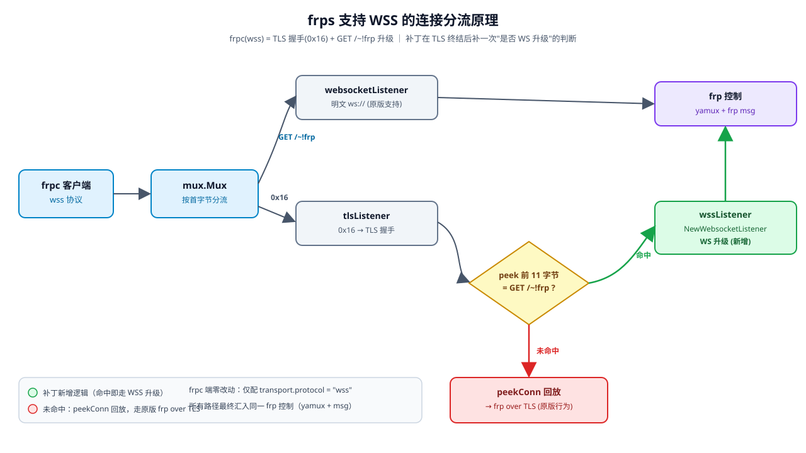

# frp-wss-ipgeo

基于 [fatedier/frp](https://github.com/fatedier/frp) **v0.71.1** 的补丁仓库，给 frps 增加两项能力：

1. **frps 直接接收 WSS（WebSocket over TLS）连接** —— 无需在前面再挂一层 nginx 或另一个 frpc 做 TLS 终结。frpc 端只需 `transport.protocol = "wss"`，同端口直连即可。
2. **后台显示客户端真实 IP 及国内归属地/运营商** —— 在 frps 日志和 Web 控制台（`:7500` / API `/api/v2/clients` 的 `clientIP` 字段）里，国内 IPv4/IPv6 显示为 `IP (省 市 运营商)`，境外与内网地址只显示 IP。

> 本仓库是**补丁**，不是完整 frp 源码。请按下方「使用方法」打到官方 frp v0.71.1 上自行编译，或直接使用 Release 里的预编译二进制。

## 功能特性

- **WSS 直连**：frps 在 `bindPort` 上同时接受原生 TCP/TLS 与 WSS；TLS 解密后探测首字节为 `GET /~!frp` 即升级为 WebSocket。
- **真实客户端 IP**：修复 `golang.org/x/net/websocket` 服务端 `RemoteAddr()` 返回 Origin 而非真实地址的问题，后台显示真实连接 IP。
- **国内归属地/运营商（在线查询，无内置数据库）**：
  - IPv4：`whois.pconline.com.cn`（省+市+运营商）→ `ipshudi.com`(ip138) → `geojs`（仅运营商兜底）。
  - IPv6：`ipshudi.com`(ip138，权威主源，省+运营商) → `geojs`（仅运营商兜底）。
  - 仅对中国大陆 IP 追加归属地；境外、内网/保留地址（`127.0.0.1`、`192.168.x`、`10.x`、`172.16-31.x`、`::1`、`fe80::` 等）只显示 IP。
  - 结果内存 + 磁盘缓存（`ipgeo_cache.json`，重启不重查），带节流与限流熔断。

## 工作原理（WSS 连接分流）

frps 在 `bindPort` 上收到连接后，先由 `mux.Mux` 按首字节分流：明文 `GET /~!frp` 走原生的明文 WebSocket 监听；首字节为 `0x16`（TLS 握手）则进入 `tlsListener` 完成 TLS 解密，再 **peek 前 11 字节**：

- **命中** `GET /~!frp` → 交给新增的 `wssListener` 做 WebSocket 升级（绿色路径，补丁新增）；
- **未命中** → 通过 `peekConn` 把已读字节回放，回到「frp over TLS」的原版行为（红色路径，兼容默认 tcp/tls 客户端）。

两条路径最终都汇入同一套 `frp 控制`（yamux + frp msg）。frpc 端零改动，仅配 `transport.protocol = "wss"` 即可。



> 流程图另存为 `docs/WSS_FRPS_流程图.jpg`（位图版）。

## 与原版相比改动的文件

```
server/wss_listener.go        # 新增：WSS channel 监听器 + peek 回放
server/service.go             # 改动：TLS 握手后 peek `GET /~!frp` 转交 WSS 升级；接入 ipgeo
server/http/controller.go     # 改动：ClientIP 字段经 ipgeo.Format 处理
pkg/util/net/websocket.go     # 改动：升级前截获真实 RemoteAddr
pkg/util/ipgeo/               # 新增：在线归属地查询包（6 个文件）
go.mod / go.sum               # 改动：golang.org/x/text 提为直接依赖（GBK 解码用）
```

## 使用方法

### 1. 打到官方源码

```bash
git clone https://github.com/fatedier/frp.git
cd frp
git checkout v0.71.1
/path/to/frp-wss-ipgeo/apply.sh "$(pwd)"   # 把补丁覆盖进来
```

### 2. 编译（需 Node + Go 1.2x）

```bash
cd web/frps && npm install && npm run build-only && cd ../..
# 如需带界面的 frpc：cd web/frpc && npm install && npm run build-only && cd ../..

# 服务端（带 Web 控制台，不要用 -tags noweb）
CGO_ENABLED=0 go build -ldflags "-s -w" -o dist_bin/frps ./cmd/frps

# 客户端（官方即可，无需补丁）
CGO_ENABLED=0 go build -ldflags "-s -w" -o dist_bin/frpc ./cmd/frpc

# 交叉编译示例（OpenWrt ARM64 软路由）
CGO_ENABLED=0 GOOS=linux GOARCH=arm64 go build -ldflags "-s -w" -o dist_bin/frps_linux_arm64 ./cmd/frps
```

### 3. 运行

frps 配置（`frps.toml`）无需任何 WSS 相关项，照常用 `bindPort`。frpc 侧：

```toml
serverAddr = "你的frps域名或IP"
serverPort = 7001
auth.method = "token"
auth.token = "xxxx"
transport.protocol = "wss"   # 关键：走 WSS

[[proxies]]
name = "ssh"
type = "tcp"
localIP = "127.0.0.1"
localPort = 22
remotePort = 6022
```

frpc 日志出现 `login to server success` 即成功。frps 后台 `/api/v2/clients` 的 `clientIP` 会显示如 `223.5.5.5 (浙江 杭州 阿里云)`；内网/境外则只显示 IP。

## 预编译二进制

见本仓库 `bin/` 目录（或在 Release 中下载），已含：

| 文件 | 架构 | 说明 |
|---|---|---|
| frps_linux_amd64 | x86_64 | 服务端（带 WSS 补丁）|
| frps_linux_arm64 | AArch64 | 服务端（带 WSS 补丁）|
| frps_windows_amd64.exe | Windows | 服务端（带 WSS 补丁）|
| frpc_linux_amd64 | x86_64 | 客户端（官方，原生支持 wss）|
| frpc_linux_arm64 | AArch64 | 客户端（官方）|
| frpc_windows_amd64.exe | Windows | 客户端（官方）|

> 注意：归属地查询需要 frps 能访问外网（ip138 / pconline / geojs）。

## 许可证

frp 原项目为 Apache-2.0（见 [fatedier/frp](https://github.com/fatedier/frp) 及本仓库 `LICENSE`）。本补丁沿用相同许可证。WSS 补丁思路与归属地查询为在官方 v0.71.1 基础上的增量修改。

## 免责声明

本仓库仅供学习/自用。部署到公网请注意安全（token 鉴权、防火墙、及时更新）。
